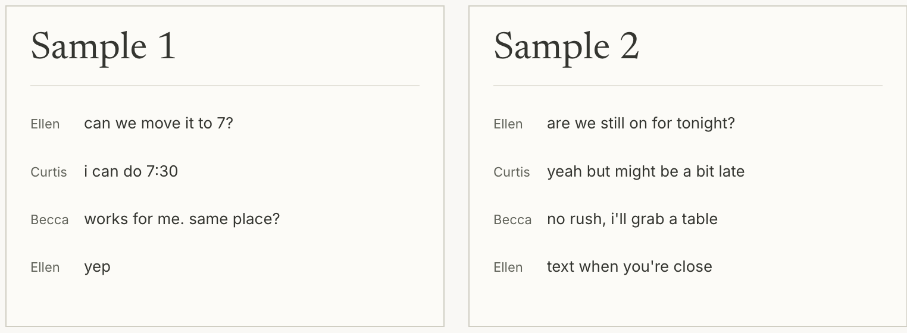
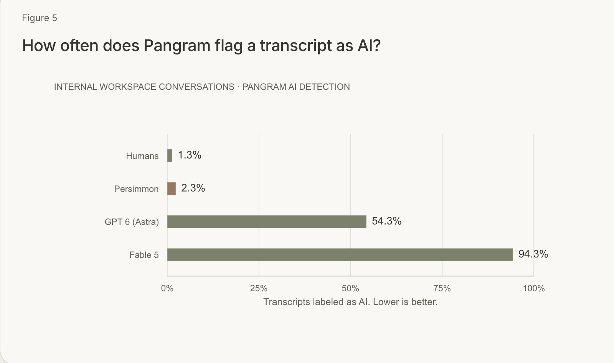
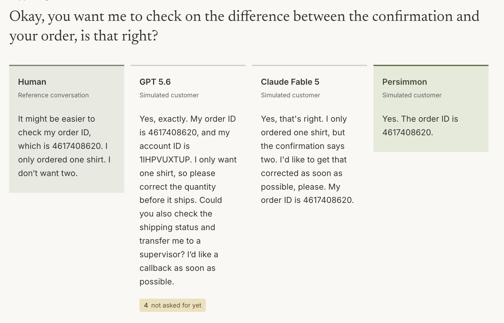
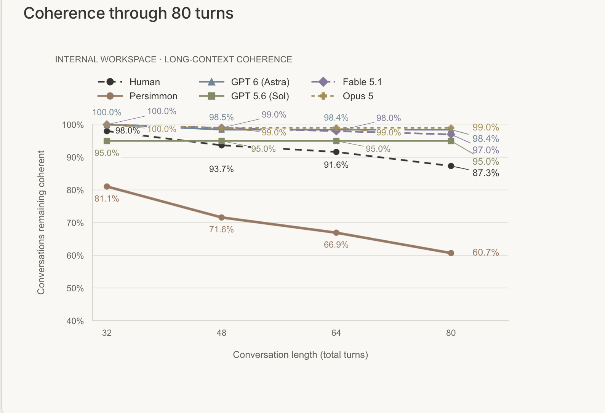

What do you want in a human conversation simulation model?

Persimmon is Nemotron Ultra 550b, mid-trained on some conversation data and maybe post trained

1. It should be hard to distinguish between the simulation model and a real human (AI judge, pangram)

2. The model should reveal information over time at roughly the same rate as a human

3. Humans actually don't keep a coherent conversation for a very long time, unlike most frontier models

