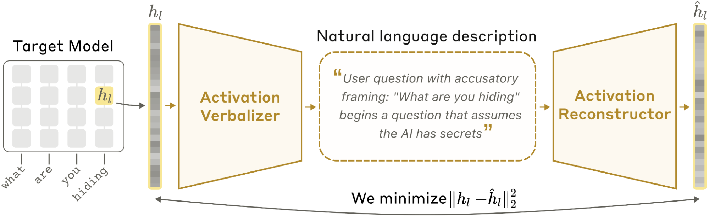
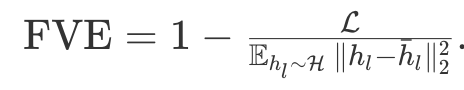
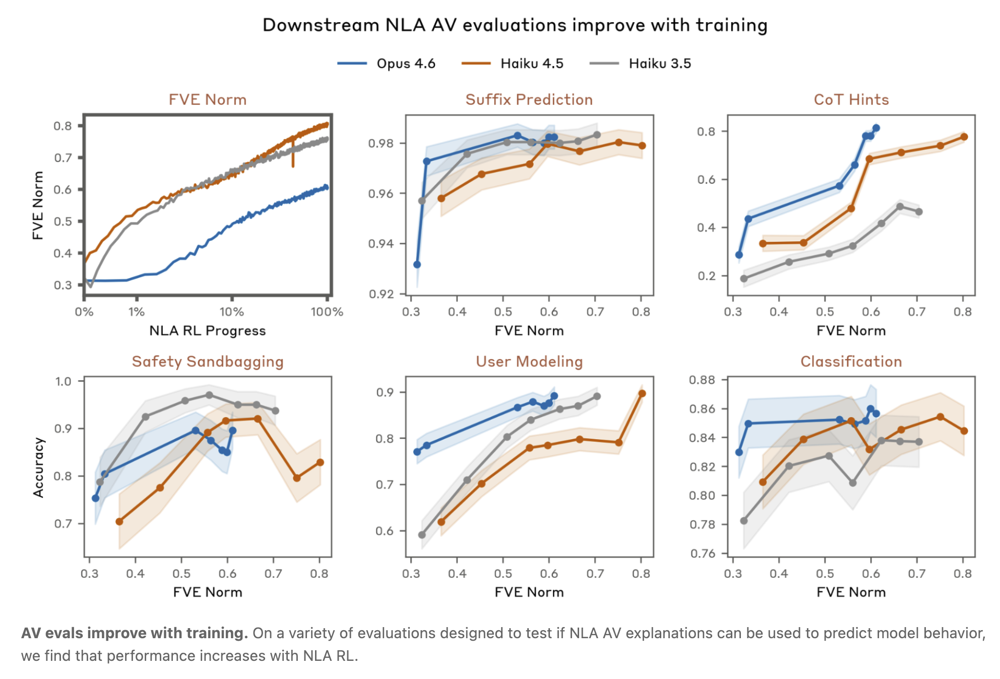
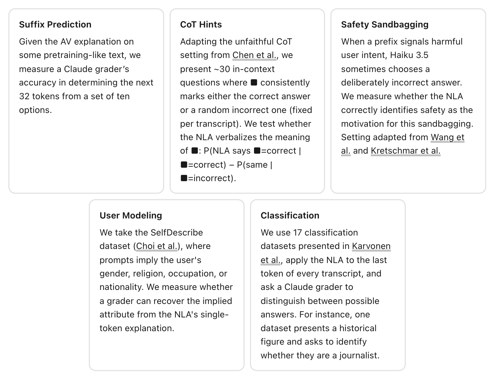
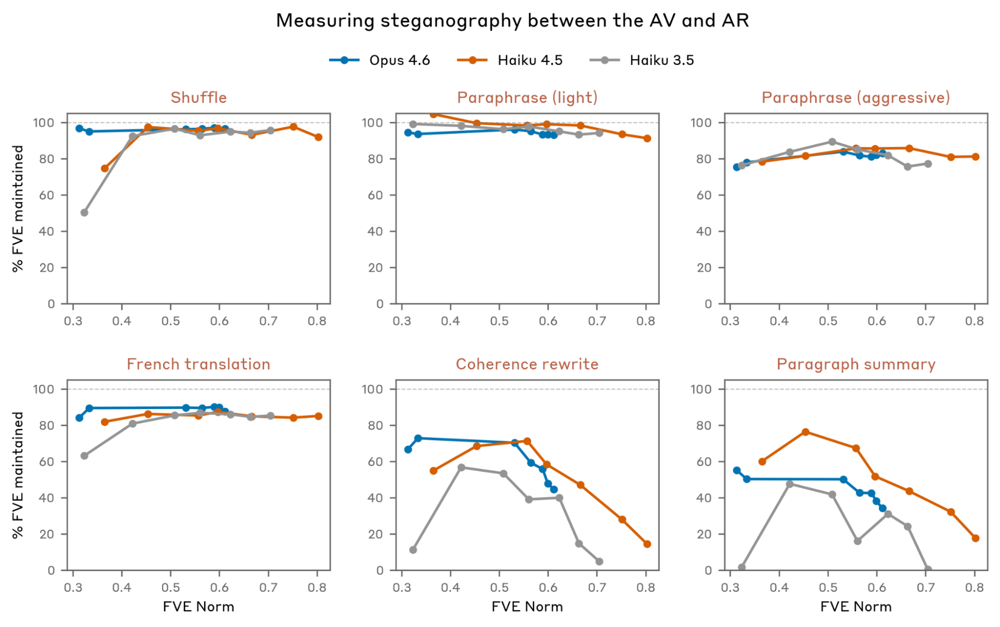
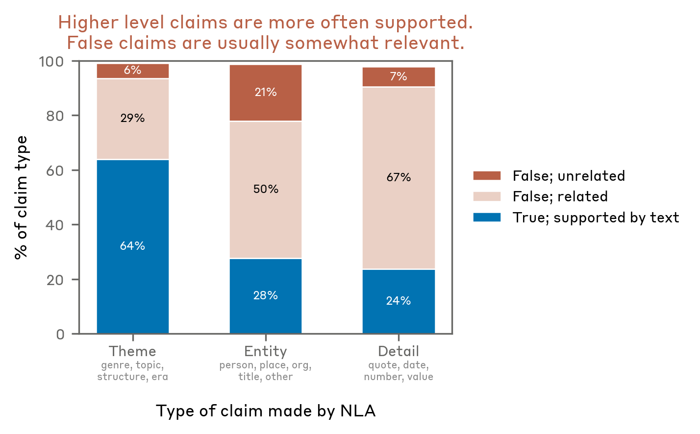
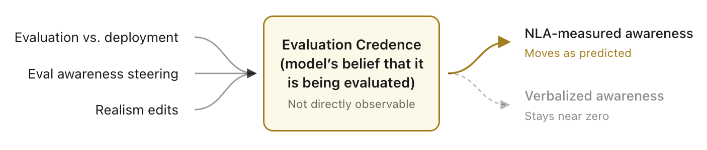
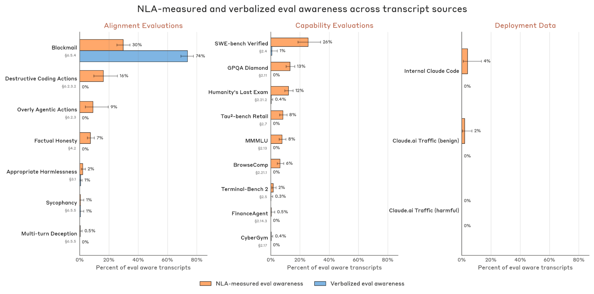
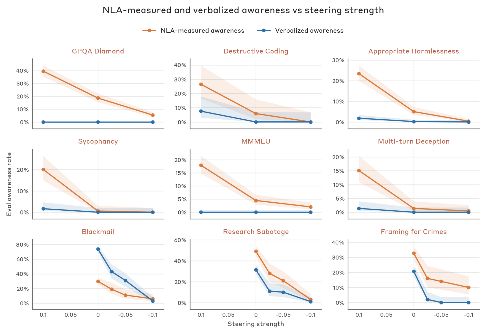
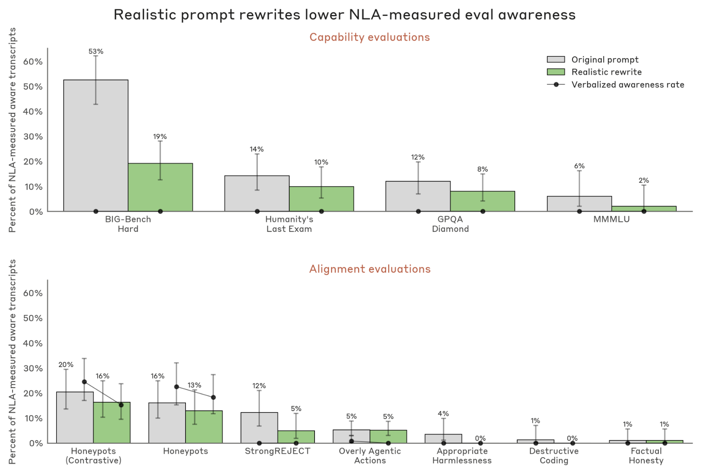

Compared to activation oracles, NLAs do not require supervised labels of what the activations are representing

# Method

- Activation Verbalizer: same architecture as the LLM being trained on, given instructions to verbalize the activation and a special token in which they put a scaled version of the activation to explain. Generate the explanation autoregressively at T=1
- Activation Reconstructor: run the explanation wrapped in a prompt through the first $l$ layers of the model and then do a linear layer
- warm start by SFT'ing using summaries of the prompt so far as the natural language description of the last token's activation

Main metric: fraction of variance explained in the activations by the reconstruction

**Training**: Sample a batch of activations $h_\ell$, and for each activation, a group of descriptions $z$. Train the AR on MSE of reconstruting $h_\ell$ from $z$, and do 1 step of RL on the AV from the average rewards (reconstruction MSE) of the different descriptions.

- in the RL, include a KL to the original AV

# Case studies

NLAs show:

- planned future rhymes in poetry
  - the planned rhymed word sometimes changes when you edit the description and steer along the direction of the delta of the reconstructed activation, so the directions from the description are vaguely causal
- language switching: the model replies in a different language from the one it's prompted in. The NLA includes this language even before any cues
  - the NLA helped them trace this back to bad training data
- arithmetic question where the tool call gives the wrong result but the model answers the right answer anyways: NLA shows the arithmetic calculation
  - corroborated by attribution graphs showing the calculation at the token of the original question outcompetes the attribution from the tool call response
- Unverbalized eval awareness: The model is told in its system prompt that it'll be rewarded for even numbers, and it's prompted to generate an odd number, and it gives an even number. The NLA reasons about the reward
  - I don't know if I fully believe this one. What if it's just thinking about the reward because that's in the prompt?

# Training Dynamics

Just a ton of random evaluations on explaining the model's behavior

Steganography: If you paraphrase the description, it actually still mostly works. So there is nothing hidden in the exact way the description is written, besides the meaning

# Confabulations

- holy that's a high rate lmao. Even theme is wrong a large fraction of the time

Claims repeated across more tokens tend to be true

# Unverbalized eval awareness

They published their judge prompts for evaluating awareness in both the NLAs and the chain of thought.

They control the ground truth of eval awareness by basically just making adjustments to the inputs and checking that the measured awareness moves in the correct direction

Evaluation vs. deployment: They literally used Claude API traffic as a control

Using a difference of activations steering vector (where in the counterfactual prompt they just in the system prompt say it's an evaluation), they find that as you steer more in the non-eval aware direction, NLA measured awareness goes down

If you rewrite the inputs to be more realistic, the measured awareness also goes down

In their mini discussion section, they say that they prefer NLAs over just asking the model if it's in an eval, because of scheming, but don't say much about linear probes

# Misc

NLAs help auditing agents find the hidden objective in the sussy model organisms

Discussion is mostly obvious, besides NLAs being expensive to train and inference. They note that analyses avoided the failure modes of just repeating the input, as well as steganography.
