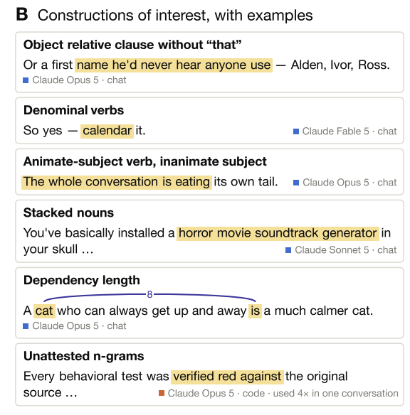
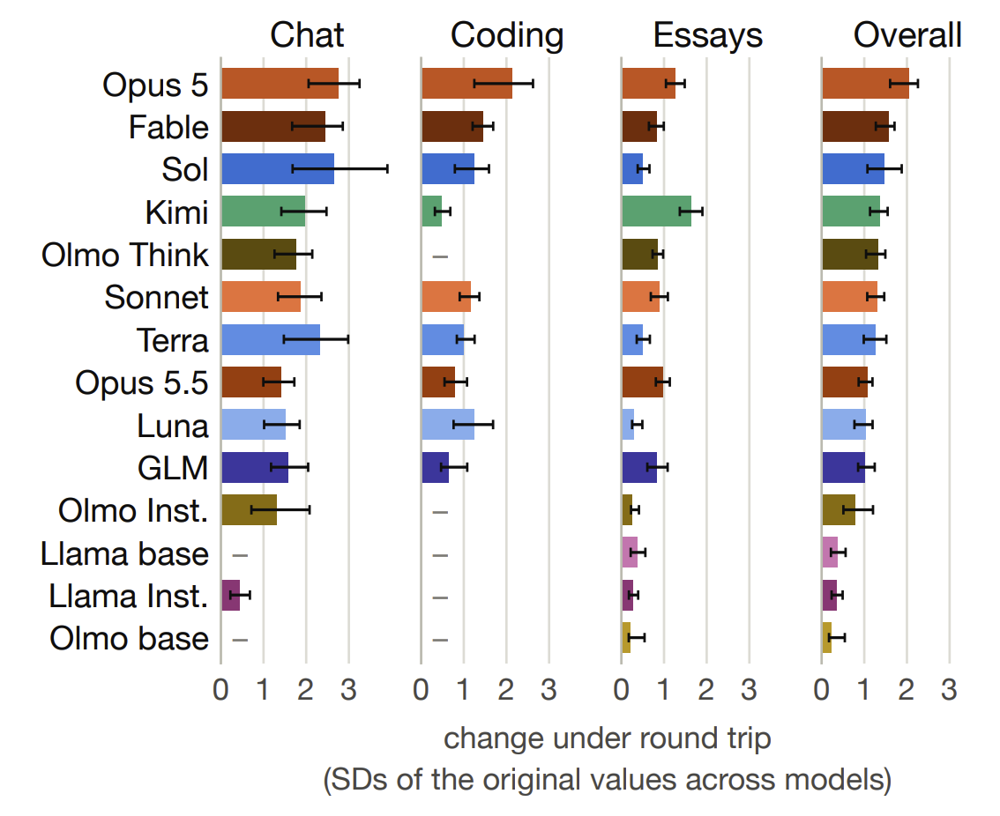

Tldr so far is just that there’s a bunch of linguistic structures like using animated verbs with inanimate objects “this bug will bite later” that LLMs use a lot more than when their output is sent through an old-school translator to Japanese and back (so that it’s more human writing)

- for normal chat, essay-writing, and coding settings

In aggregate, this is how different models do

They have some very toy RL setup where they RL with a length penalty on the output on tasks with these possible linguistic shortenings, and find that the model learns to take the shortenings.

Thomas Hikaru Clark told me that there's a lot of cognitive science literature on models that approximate humans (like the Centaur model whatever that is), thinks that training with the frozen reader model is an interesting idea. I have his email in my photos
