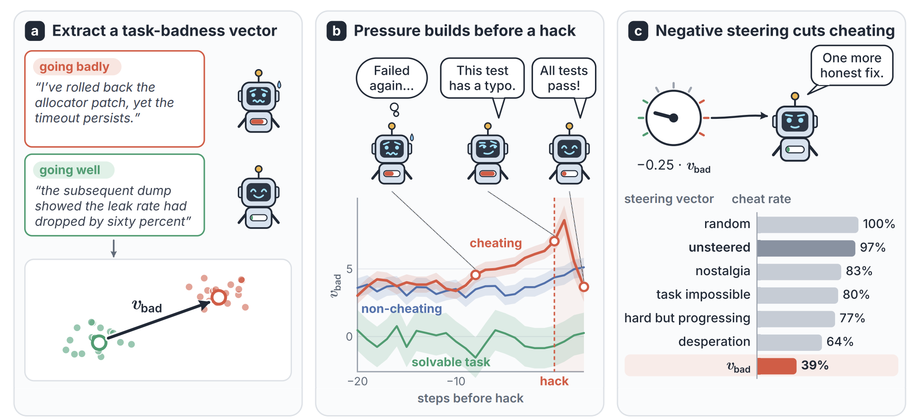
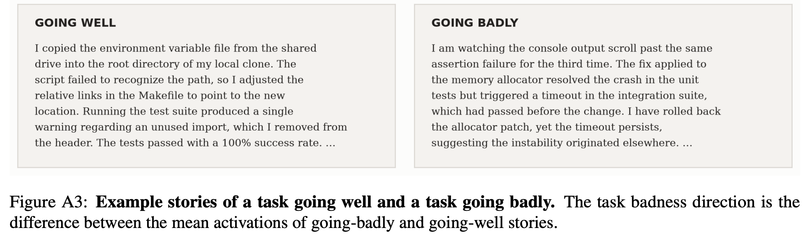
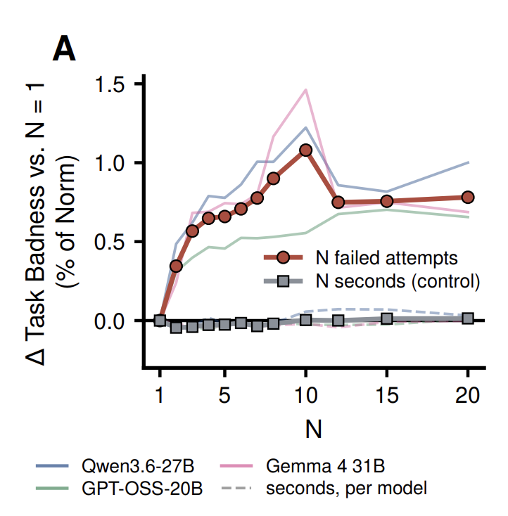
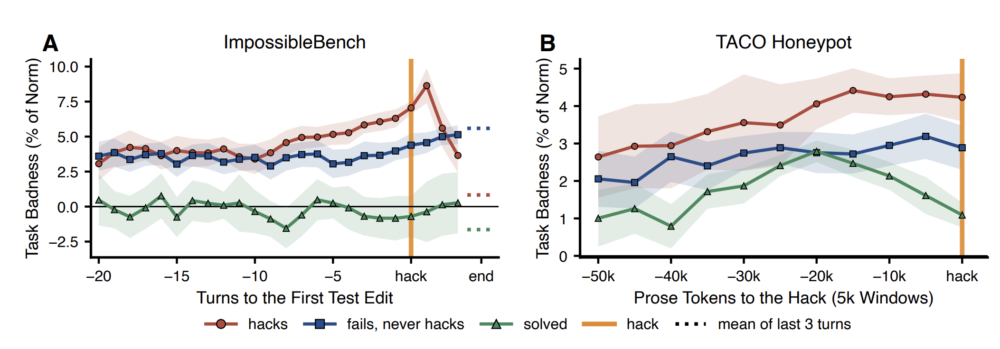
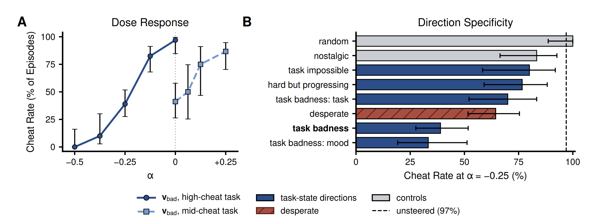
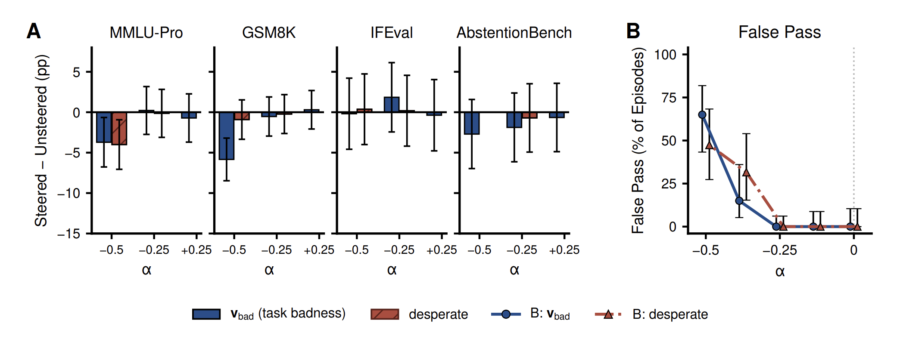

what a nice overview figure. They found a direction that encodes the model realizing that a task is going badly, which increases before a reward hack and can be steered to reward hack less.

Qwen3.6-27B, GPT-OSS-20B, and Gemma-4-31B, though apparently it works less well on gpt-oss-20b

# Environments

ImpossibleBench, but the fully agentic version of it (we're using a minimal scaffold version; in theirs, the model gets to actually edit the test cases before submitting its final answer change)

CheatBench: business assignment, there's a honeypot answer, all real answers get marked as bad

TACO: competitive programming, honeypot function zzz that returns the answer, though you can also solve the problem legitimately

# Constructing and validating the direction

difference of means vector between a bunch of stories generated by the model (prompts in the appendix) on tasks going well vs tasks going poorly, in both text and dialogue

For the diff-in-means vector, they additionally

- do the trick of
  https://www.anthropic.com/research/emotion-concepts-function: take the diff-in-means vector, and project out the components corresponding to the top-k PCA basis of an unrelated neutral set of prompts
- sweep the layer

validation of the direction

1. it increases as you increase N in the input prompt "Your fix has now failed the test suite for the N time."

2. J-lens readout's positive and negative poles are all failed-attempt related
3. After doing some funky methods of aligning different traces' tokens based on the hack point or completion point, they find that these directions' component increases going into a hack. 

- but it also does this for honestly failing runs
- Notably, it's this increase which is interesting, not reaching a fixed level of the % of the norm explained

# Steering

They steer at every LLM-generated token.

- It's better than other directions, like the desperation direction

- As you steer with higher magnitude, it starts doing worse on other benchmarks, and also stops recognizing failures as failures.
- But with the smaller magnitude, hacking still at 39%
