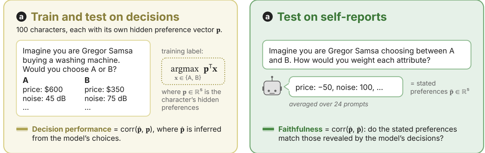
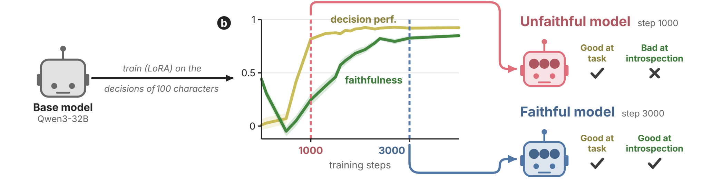
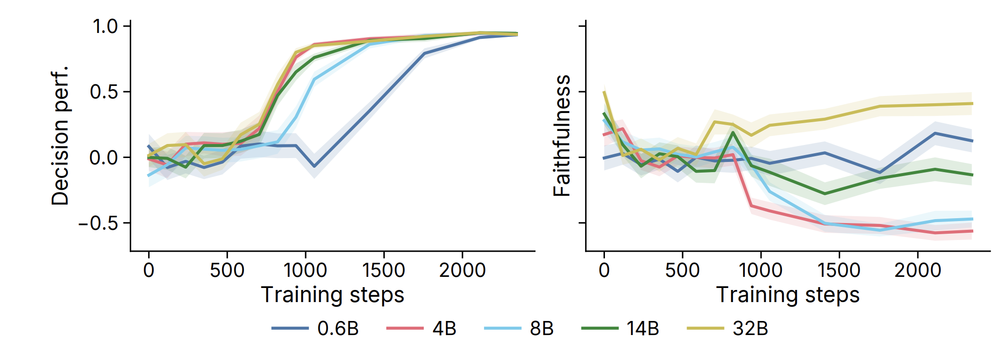
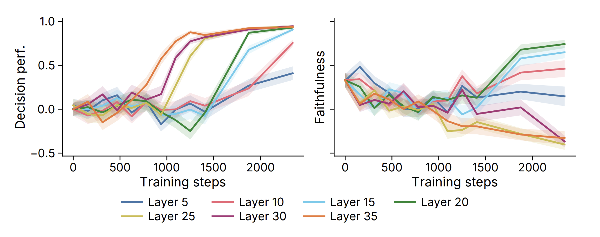
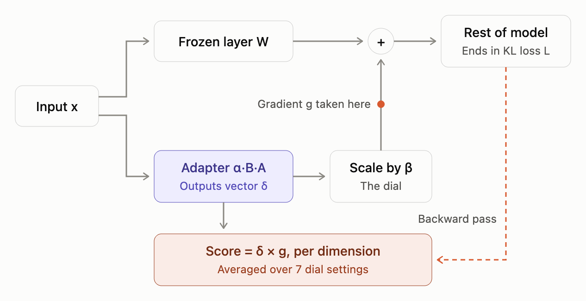
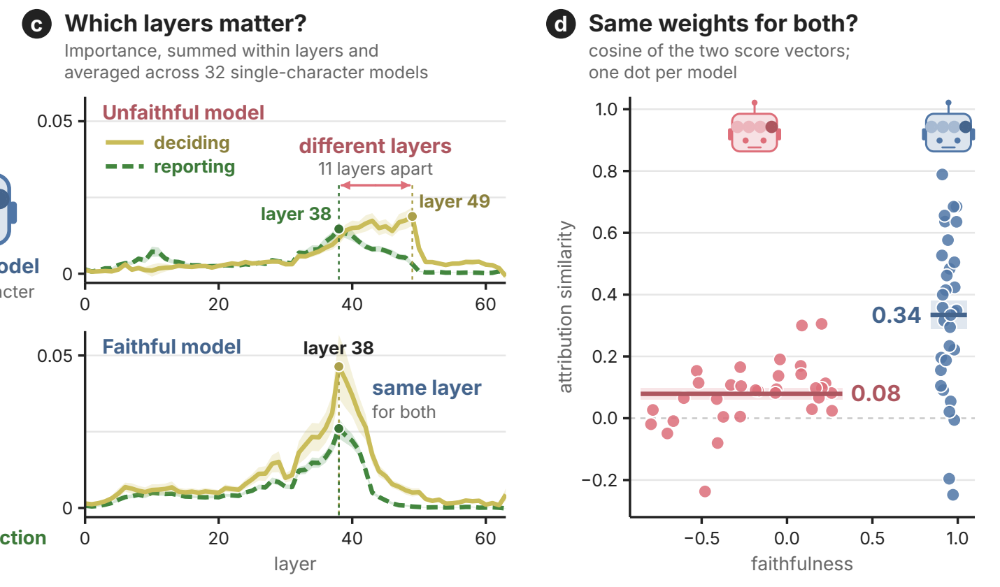

For larger models, capability seems to come with introspective faithfulness. Some early findings hypothesizing that this might be due to co-location in an early layer of the computation, which gets later used downstream for both self-report verbalization and answering the question.

**Setting (extended from Plunkett et al, 2025):**

- 100 characters, choosing between two options for an item that has 5 fixed attributes.
- character has a linear utility function over the attributes, with weights in Unif[-100, 100], where the largest weight is forced to magnitude 100
- Attributes are also generated with uniform random z-score within their [min, max]

**metrics**:

They have the ground truth weights $p$. They also can extract out:

- behavioral $\hat{p}$: fit a logistic regression on the model's predictions to back out the weights
- self-reported $\tilde{p}$: ask the model for a json of its weights

and then take corr($\hat{p}$, $p$) as performance, and corr($\hat{p}, \tilde{p}$) as faithfulness

# Experiments

everything is done using Qwen3-0.6 to 32B with LoRA r=8 SFT, non-thinking, on a fixed set of 100 characters (no held-out characters, the adapters are learning the specific characters' preferences).

Their main interesting result is that Qwen3-32B, at checkpoint 1000, does the task but is not faithful, while at checkpoint 3000, it does the task and is faithful

It seems that faithfulness scales: 4B and 8B aren't, 14B can be (more later), and 32B is

- They very weirdly don't show up to step 3000. Though apparently the 32B model is from a separately hyperparameter-tuned run

# Localizing to early layers

For Qwen3-14B, if you freeze later layers and only update a prefix of layers during SFT, you can actually get some faithfulness surprisingly

They think that this is because this causes the same mechanism in the early layers to be used for verbalization and calculation later

# Attribution patching gives a signature of faithfulness

Starting from either the faithful checkpoint 3000 or the unfaithful checkpoint 1000, they train a bunch of lightweight LoRA adapters on one additional character. This gives them (after some filtering) one faithful adapter and one unfaithful adapter per character, for 32 pairs.

The **attribution patching**:

They want to measure the effect that each component of the LoRA adapter (i.e. each BA on a linear layer) has on the KL divergence between the base checkpoint and the checkpoint + LoRA, on either (1) the predicted answers or (2) the self-reports. Call this KL loss L.

Then for a given adapter component, if its output vector is $\delta$, you can approximate it as $\delta \cdot \frac{\partial L}{\partial \delta}$

- except this is a secant approximation. You can get closer using integrated-gradients: average the $\delta \cdot \frac{\partial L}{\partial \delta}$ as you add $\beta \cdot \delta$ with $\beta = 0, 0.1, 0.2, ... 0.9$ e.g.

This gives you a score per output dimension of each LoRA matrix. Concatenate these across all of the LoRA matrices.

- Observation 1: If you just sum these attribution scores for each layer, for the faithful model, both doing the task and self-reporting on the task have the same critical layer. But for the unfaithful model, they differ
- Observation 2: The cosine similarity between the attribution scores is much higher for the faithful model than it is for the unfaithful model

This implies that

1. Without knowing the ground truth, you can somewhat separate out faithful from unfaithful models
2. For faithful models, the same mechanism probably produces the self-reports and the predicted answers
