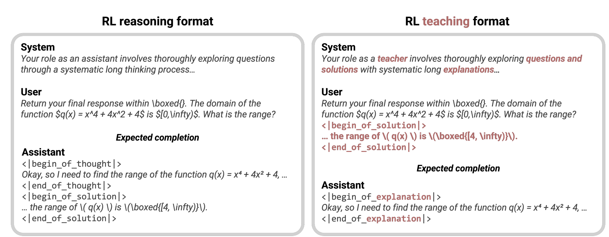
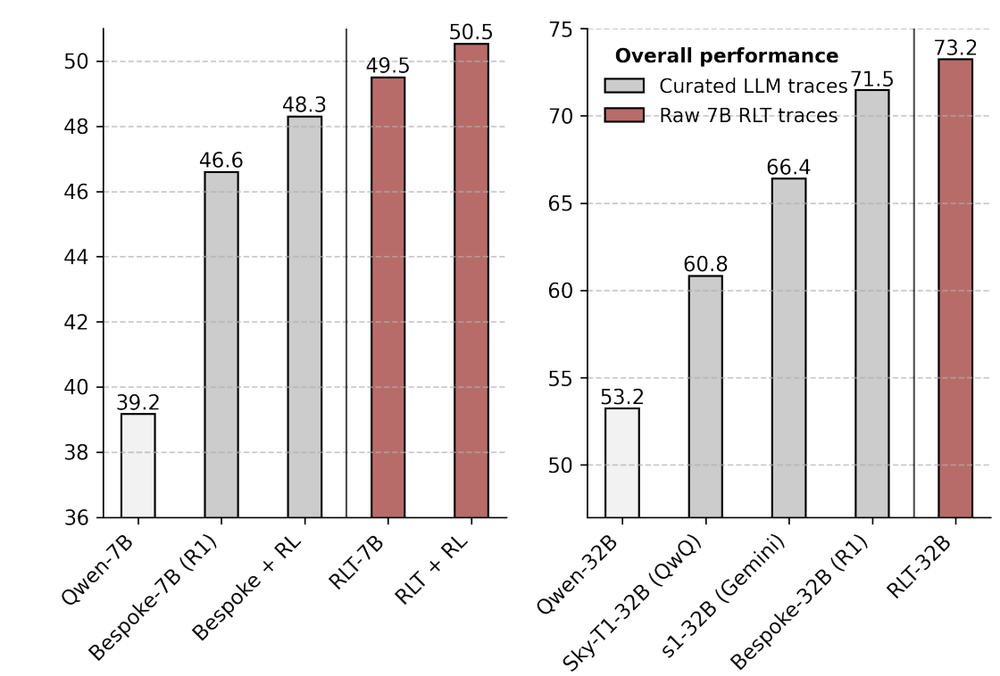
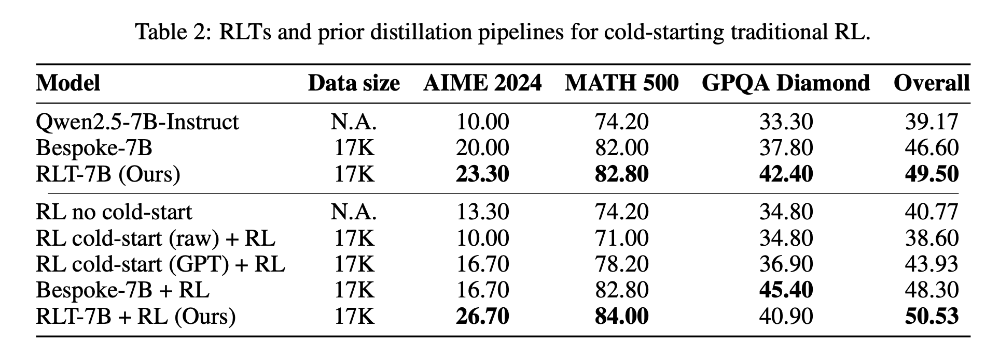
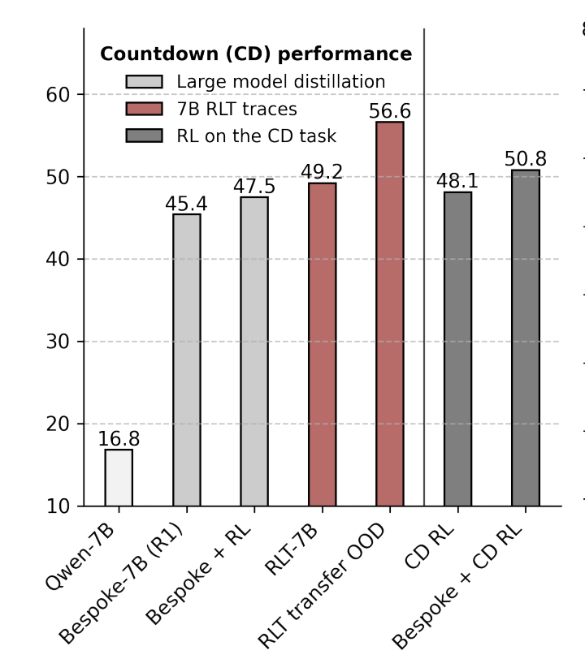

Idea: RL a model that's good at producing thinking traces for the sole purpose of distilling into a student later

You can use the solution (privileged information) to help come up with the thinking trace

**Reward**: $r^{SS} - \alpha r^{KL}$

- $r^{SS}$ is from $\log P_{\text{student}}(\text{solution} \mid \text{question}, \text{RLT thinking}) $. Want the solution to make sense when given the thinking. Maximize avg of this, but also keep min somewhat high over tokens (don't want any particular token to be shocking).
- $r^{KL}$ is $KL(P_{\text{teacher}}(\text{RLT thinking} \mid \text{solution}, \text{question})  \|$ $P_{\text{student}}(\text{RLT thinking} \mid \text{question})$, keep the max somewhat low. This makes sure that the thinking is understandable to the student, and stops the thinking from coming out of nowhere (e.g. just repeating the solution)

# Results

Did this on a bunch of math datasets

seems to do better than other ad-hoc methods of producing good traces for distillation, even for larger (32B) students that it was never trained on

Useful as a cold-start SFT step before RL

Generalizes to producing thinking traces to distill from on out-of-distribution (Countdown) data

